# 🛒 All'DTech - E-commerce de Tecnologia (Projeto Acadêmico)

> Plataforma web full-stack desenvolvida como **projeto acadêmico** para o comércio de eletrônicos, hardware e periféricos, focando em alta performance, arquitetura relacional em banco de dados, segurança rigorosa de autenticação e excelente experiência de usuário (UX/UI).

<div align="center">


</div>

---

## 🎯 Sobre o Projeto
O **All'DTech** nasceu no contexto acadêmico com o objetivo de aplicar na prática conceitos de desenvolvimento web full-stack. O sistema simula um e-commerce completo de tecnologia, integrando um front-end moderno e responsivo com um back-end robusto em **PHP** e persistência de dados relacional em **MySQL** (gerenciado via **Apache/XAMPP**).

---

## 🛠️ Tecnologias e Ferramentas Utilizadas
* **Front-end:** HTML5, CSS3 (Flexbox, Design Responsivo, Tema Escuro/Claro e Ajuste Dinâmico de Fontes).
* **Back-end:** PHP (Gerenciamento de Sessões, Autenticação e Processamento de Formulários).
* **Banco de Dados:** MySQL (Schemas relacionais com chaves primárias e estrangeiras, gerenciados via phpMyAdmin).
* **Controle de Versão:** Git e GitHub.

---

## ✨ Funcionalidades Principais & Telas do Sistema

### 1. Página Inicial e Navegação (Home)
* **Carrossel Dinâmico:** Destaque de ofertas e banners promocionais.
* **Seções em Destaque:** Super destaques e produtos em oferta.
* **Barra de Pesquisa Centralizada:** Localizada no topo para busca rápida de componentes.
* **Menu Multinível (Hambúrguer):** Navegação estruturada em departamentos e subcategorias (Hardware, Monitores Gamer, Cadeiras Gamer).

<div align="center">
  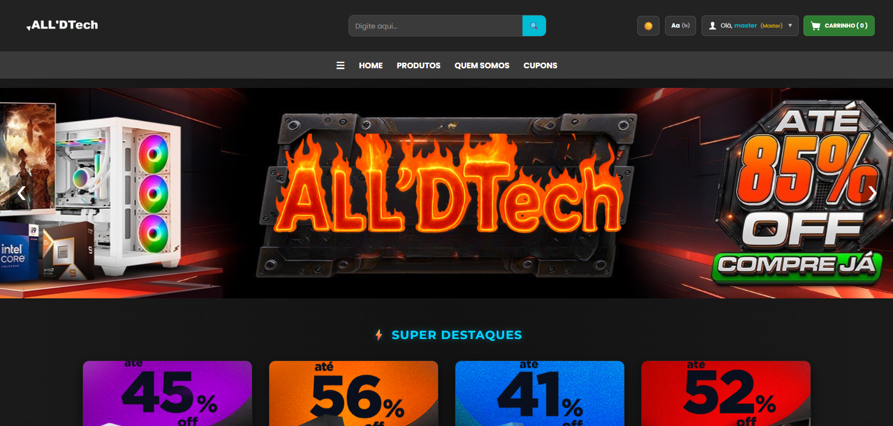
</div>

---

### 2. Vitrine de Descontos Natalinos
* Seção especial destacando ofertas sazonais com percentuais de desconto, preços promocionais e botões dinâmicos de adição ao carrinho.

<div align="center">
  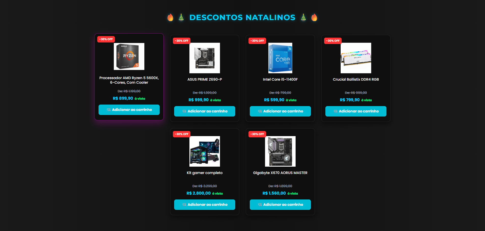
</div>

---

### 3. Menu de Navegação e Categorias (Menu Hambúrguer)
* Sistema expansível em árvore para facilitar a busca por subcategorias específicas como Placas de Vídeo e Processadores.

<div align="center">
  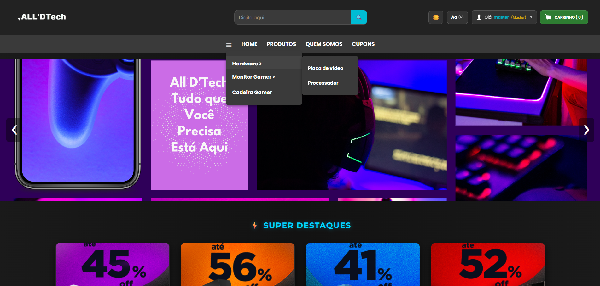
</div>

---

### 4. Autenticação e Segurança (Login)
* Sistema de login integrado ao banco de dados com validação de credenciais e feedback visual dinâmico de sucesso.

<div align="center">
  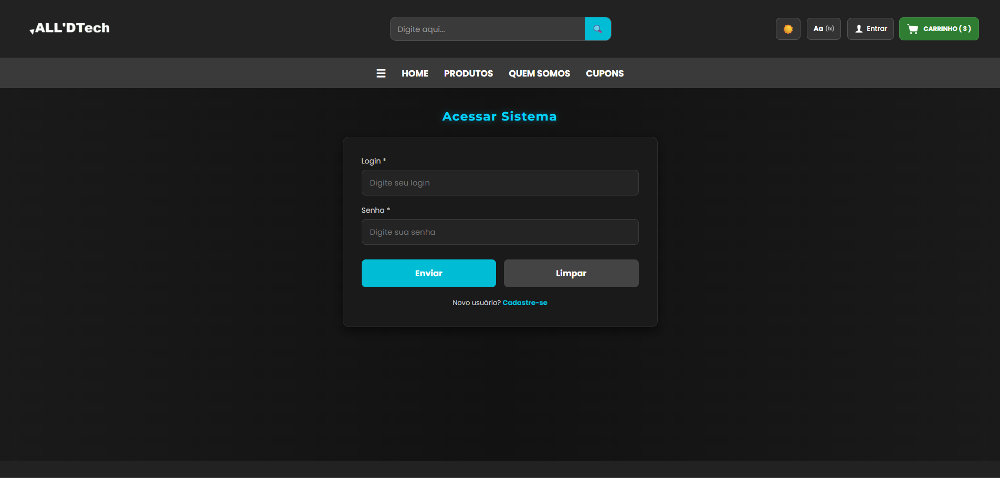
  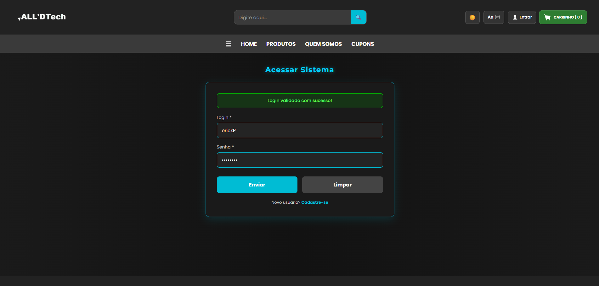
</div>

---

### 5. Cadastro de Usuários com Validação Estrita
* Formulário detalhado com validação em tempo real de dados essenciais (Nome, CPF, E-mail, Telefones, Endereço e Perguntas de Segurança).

<div align="center">
  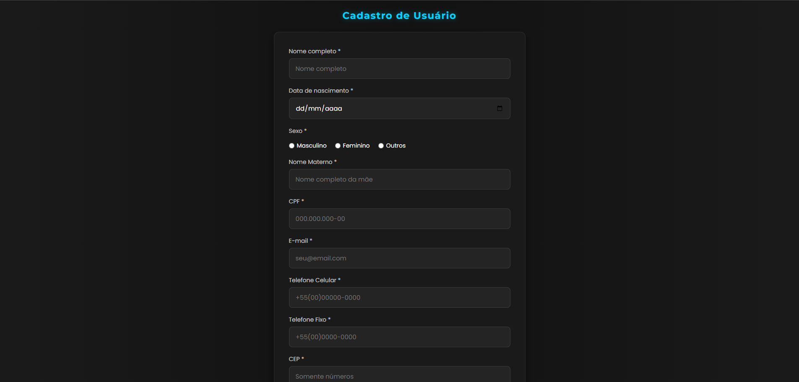
  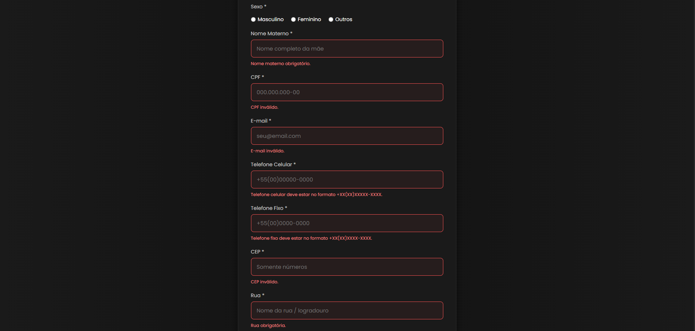
  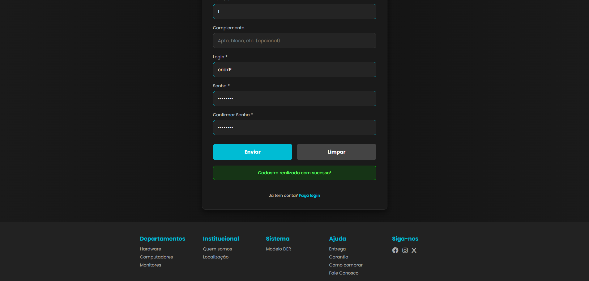
</div>

---

### 6. Área do Usuário Comum: Alteração de Senha
* Funcionalidade exclusiva para o usuário comum autenticado gerenciar e alterar sua senha com segurança informando a senha atual.

<div align="center">
  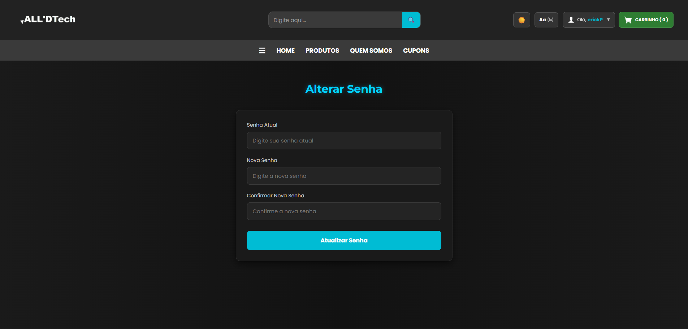
</div>

---

### 7. Carrinho de Compras Interativo
* Gerenciamento dinâmico de itens, cálculo automático de subtotal e total, além de opções para exclusão de produtos ou esvaziamento do carrinho.

<div align="center">
  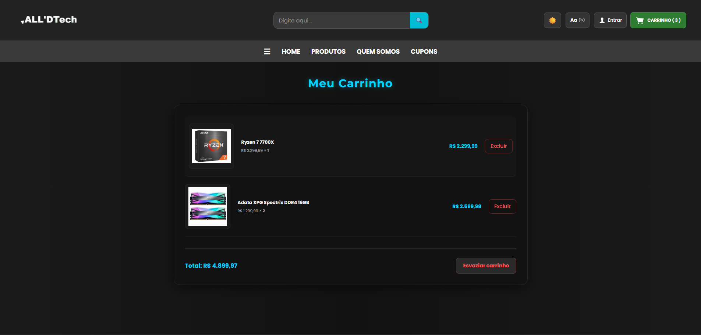
</div>

---

### 8. Cupons de Desconto
* Seção interativa com cupons promocionais aplicáveis para placas de vídeo, memórias e primeira compra.

<div align="center">
  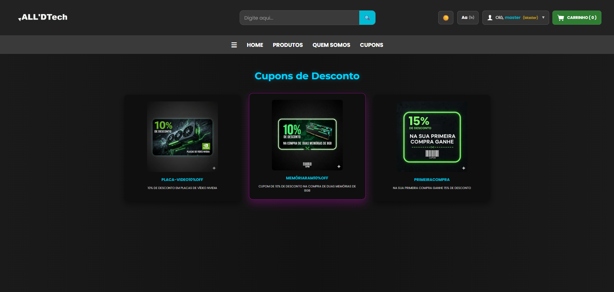
</div>

---

### 9. Painel Administrativo Master (Controle de Usuários e Logs)
* Área restrita e exclusiva para o perfil **master**, permitindo o gerenciamento completo de usuários cadastrados no sistema e a auditoria de acessos através dos logs da plataforma.

<div align="center">
  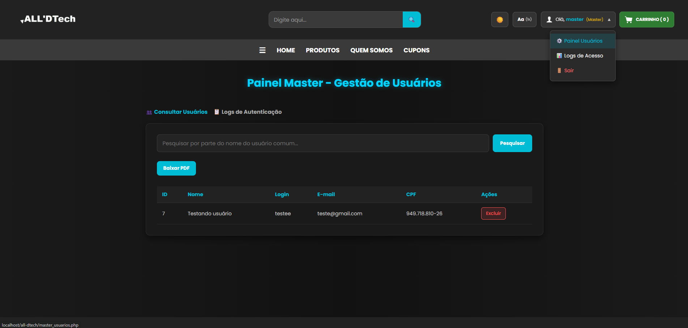
</div>

---

## 🔒 Requisitos de Segurança e Requisitos Acadêmicos
* **Autenticação em Dois Fatores (2FA Obrigatório):** Validação estrita exigida para todos os usuários (incluindo o perfil master), baseada em perguntas de segurança (`nome materno`, `data de nascimento` ou `CEP`), limitadas a 3 tentativas.
* **Logs de Acesso:** Auditoria e monitoramento de logins na tabela `logs_acesso` do banco de dados `all_dtech`.
* **Acessibilidade e Customização:** Ferramentas integradas no cabeçalho para alternância de tema (Dark/Light mode) e redimensionamento dinâmico de fonte.

---

## ⚙️ Como Executar o Projeto Localmente

1. Certifique-se de ter o **XAMPP** (ou ambiente PHP/MySQL equivalente) instalado.
2. Clone este repositório para a pasta `htdocs` do seu servidor local:
   ```bash
   git clone https://github.com/Erick-de-Paiva/site-All-dTech.git
   ```
3. Inicie os serviços do **Apache** e do **MySQL** no painel de controle do XAMPP.
4. Importe o arquivo de banco de dados localizado em `database/all_dtech.sql` utilizando o phpMyAdmin.
5. Acesse a aplicação através do navegador:
   ```text
   http://localhost/all-dtech/index.php
   ```

---

Desenvolvido por **Erick de Paiva** — Estudante de Análise e Desenvolvimento de Sistemas.
